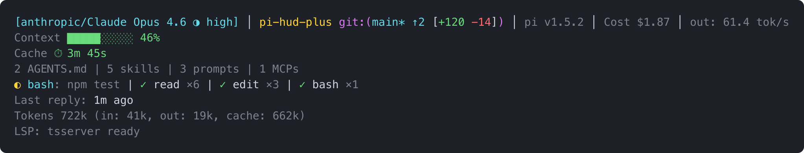

# pi-hud-plus

A [claude-hud](https://github.com/jarrodwatts/claude-hud)-style HUD for [pi](https://pi.dev): it replaces pi's footer with model, context, git, tools, cache and session information, configured with claude-hud's field names.



## Install

```bash
pi install npm:pi-hud-plus
```

Or try it once without installing:

```bash
pi -e npm:pi-hud-plus
```

The HUD runs only in pi's interactive TUI. Print, JSON and RPC modes are left alone.

## Commands

- `/pi-hud:setup` asks for a layout, a Preset (Full, Essential or Minimal) and a language, then opens a settings list pre-filled from the Preset.
- `/pi-hud:configure` opens the same list on your current config. With no config file yet, it runs setup's questions first.

In the list, Enter or Space changes a row. The rows are layout, language, git style (`off`, `branch`, `branch+dirty`, `full`, `file stats`), one on/off row per Element, the Custom line, and Reset to preset. Press Esc when you're done: you'll see the changes and confirm before anything is saved. pi-hud-plus then writes `~/.pi/agent/pi-hud-plus.json` and reloads.

Only the rows you changed are written. Every other field in the file is kept, including colors, thresholds and `extraCommand`. If the file isn't valid JSON, the commands refuse to touch it.

## Lines and Elements

The default `lineLayout` is `"expanded"`: one Line per Element, in `elementOrder`. Lines with nothing to show are left out. Every Line is cut to the terminal width with `…`.

| Element | What it shows | Toggled by |
|---|---|---|
| `project` | `[model]` badge, project path, `git:(branch* ↑2 ↓1 [+120 -14])`, then session name, `pi vX`, the Extra command's label, session duration, cost and output speed | `display.showModel`, `display.showProject`, `gitStatus.enabled`, `display.showSessionName`, `display.showVersion`, `extraCommand`, `display.showDuration`, `display.showCost`, `display.showSpeed` |
| `context` | `Context ██████░░░░ 46%`, coloured by the warning and critical thresholds. At or above the critical threshold it adds the latest reply's `(in: …, cache: …)` split | `display.showContextBar`, `display.contextValue`, `display.showTokenBreakdown` |
| `usage` | `Usage ██░░░░ 25% (resets in 1h 30m)`: the 5h Limit window, plus `\| Weekly …` and `\| Monthly …` at or above `sevenDayThreshold`, or a Balance (`Usage ¥4.12`). For Codex models, from ChatGPT's rate limits; for other models, from the External usage snapshot file | `display.showUsage`, `display.usageValue`, `display.usageBarEnabled`, `display.showResetLabel`, `display.usageCompact`, `display.usageThreshold`, `display.sevenDayThreshold`, `display.externalUsagePath` |
| `promptCache` | `Cache ⏱ 3m 45s`: time left on the prompt cache since the last reply, yellow near the end, then `expired` | `display.showPromptCache`, `display.promptCacheTtlSeconds` |
| `memory` | `Approx RAM ████░░ 12 GB / 16 GB (75%)`: system RAM. Expanded layout only | `display.showMemoryUsage` |
| `environment` | `2 AGENTS.md \| 5 skills \| 3 prompts \| 1 MCPs`: what shapes the agent's context. MCPs are the distinct `mcp__<server>__*` tool namespaces | `display.showConfigCounts`, `display.environmentThreshold` |
| `tools` | Up to two running tools with their target (`◐ bash: npm test`), then finished tools by count (`✓ read ×6`) | `display.showTools`, `display.toolNameMaxLength`, `display.toolsMaxVisible` |
| `sessionTime` | `Started: 42m ago │ Last reply: 1m ago` | `display.showSessionStartDate`, `display.showLastResponseAt`, `display.timeFormat` |

Two Lines aren't Elements and so aren't part of `elementOrder`:

- **Session tokens**: `Tokens 722k (in: 41k, out: 19k, cache: 662k)`, summed over the session the way pi's footer sums them. It comes after the Element Lines. Toggled by `display.showSessionTokens`.
- **Extension statuses**: other extensions' footer statuses, sorted by key, on one dimmed Line. It is always last. Toggled by `display.showExtensionStatuses`.

The **Custom line** (`display.customLine`) is static text that goes at the start or end of the `project` Line (the session Line in the compact layout), depending on `display.customLinePosition`.

With `"lineLayout": "compact"`, everything goes on one session Line (model badge, context, project and git, then the other enabled Elements), with the tools Line under it. Memory isn't shown, and `elementOrder` and `mergeGroups` don't apply.

`display.mergeGroups` joins Elements that sit next to each other in `elementOrder` onto one Line, separated by ` │ `, when they fit. The default `[["context", "usage"]]` puts usage beside the context bar. `showSeparators` draws a rule above the tools Line.

## Config

pi-hud-plus reads one JSON file, `~/.pi/agent/pi-hud-plus.json`, for every project. There's no per-project file. The file is optional. A file that is missing or doesn't parse counts as empty, so the HUD still renders. Each field is validated on its own: an invalid value falls back to that field's default, and unknown fields are ignored.

The file is read when a session starts. After editing it, run `/reload`.

### Field reference

Top level:

| Field | Default | Values |
|---|---|---|
| `language` | `"en"` | `"en"`, `"zh-Hans"` (`"zh"` is accepted as `"zh-Hans"`) |
| `lineLayout` | `"expanded"` | `"expanded"`, `"compact"` |
| `showSeparators` | `false` | boolean |
| `pathLevels` | `1` | `1`, `2`, `3`: how many trailing directories of the cwd to show |
| `elementOrder` | `["project", "context", "promptCache", "memory", "environment", "tools", "sessionTime"]` | Elements in Line order. Leaving an Element out hides its Line. Unknown ids and duplicates are dropped |
| `extraCommand` | `""` (off) | shell command, see [Extra command](#extra-command) |

`gitStatus`:

| Field | Default | Values |
|---|---|---|
| `enabled` | `true` | boolean. When off, no git commands run |
| `showDirty` | `true` | boolean: `*` after the branch when the tree is dirty |
| `showAheadBehind` | `false` | boolean: `↑n ↓n` against the upstream |
| `showFileStats` | `false` | boolean: line diff `[+n -n]` plus a last Line listing up to 6 changed files, newest first (expanded), or file counts `!n +n ✘n ?n` (compact) |
| `branchOverflow` | `"truncate"` | `"truncate"` keeps project and git in one segment; `"wrap"` gives git its own segment |
| `pushWarningThreshold` | `0` (off) | colour `↑n` with `colors.warning` from this many unpushed commits |
| `pushCriticalThreshold` | `0` (off) | colour `↑n` with `colors.critical` from this many unpushed commits |

`display`:

| Field | Default | Values |
|---|---|---|
| `showModel` | `true` | boolean. The badge is prefixed with `provider/` when more than one provider is available, like pi's footer |
| `modelFormat` | `"full"` | `"full"`; `"compact"` strips a `(… context)` suffix; `"short"` also strips a leading `Claude ` |
| `modelOverride` | `""` | text shown instead of the model name (max 80 chars) |
| `showThinkingLevel` | `false` | boolean: `○ low`, `◔ medium`, `◑ high`, `◕ xhigh` in the badge |
| `showProject` | `true` | boolean |
| `showSessionName` | `false` | boolean |
| `showVersion` | `false` | boolean: `pi vX` |
| `showDuration` | `false` | boolean: `⏱️  42m` since the session started |
| `showCost` | `false` | boolean: `Cost $1.87`, with `(sub)` on a subscription |
| `showSpeed` | `false` | boolean: `out: 61.4 tok/s` of the streaming reply |
| `showContextBar` | `true` | boolean. Off shows the value only |
| `contextValue` | `"percent"` | `"percent"`, `"tokens"` (`92k/200k`), `"remaining"`, `"both"` |
| `contextWarningThreshold` | `70` | 0–100 |
| `contextCriticalThreshold` | `85` | 0–100 |
| `showTokenBreakdown` | `true` | boolean: `(in: …, cache: …)` at or above the critical threshold |
| `showUsage` | `true` | boolean |
| `usageValue` | `"percent"` | `"percent"` used, `"remaining"` |
| `usageBarEnabled` | `true` | boolean |
| `showResetLabel` | `true` | boolean: `resets in` before the reset time |
| `usageCompact` | `false` | boolean: `5h: 25% (1h 30m)` |
| `usageThreshold` | `0` | 0–100: hide usage until 5h or Weekly reaches this |
| `sevenDayThreshold` | `80` | 0–100: show Weekly and Monthly at or above this (`0` = always) |
| `externalUsagePath` | `""` | path of an External usage snapshot file in claude-hud's format |
| `externalUsageFreshnessMs` | `300000` | ignore the snapshot once its `updated_at` is older than this |
| `showPromptCache` | `false` | boolean |
| `promptCacheTtlSeconds` | `300` | positive whole number |
| `showMemoryUsage` | `false` | boolean |
| `showConfigCounts` | `false` | boolean: the Environment line |
| `environmentThreshold` | `0` | hide the Environment line until the counts add up to this |
| `showTools` | `false` | boolean |
| `toolNameMaxLength` | `0` (no limit) | cut tool names to this many chars. When set, MCP tools show only their tool name |
| `toolsMaxVisible` | `4` | how many finished tools to list; `0` lists all |
| `showSessionStartDate` | `false` | boolean |
| `showLastResponseAt` | `false` | boolean |
| `timeFormat` | `"relative"` | `"relative"` (`3m ago`), `"absolute"` (`2026-11-14 09:30`), `"both"`; `"elapsed"` and `"elapsedAndAbsolute"` read like `"relative"` and `"both"` |
| `showSessionTokens` | `false` | boolean |
| `showExtensionStatuses` | `true` | boolean |
| `mergeGroups` | `[["context", "usage"]]` | arrays of at least two Elements; `[]` turns merging off |
| `customLine` | `""` | static text (max 80 chars) |
| `customLinePosition` | `"last"` | `"first"`, `"last"` |

`colors`: each value is a name (`"dim"`, `"red"`, `"green"`, `"yellow"`, `"magenta"`, `"cyan"`, `"brightBlue"`, `"brightMagenta"`), a 256-colour index (`0`–`255`) or a hex string (`"#rrggbb"`).

| Field | Default | Colours |
|---|---|---|
| `context` | `"green"` | context value and bar below the warning threshold |
| `usage` | `"brightBlue"` | usage below 75% |
| `usageWarning` | `"brightMagenta"` | usage at 75% or more (90% and up is `critical`) |
| `warning` | `"yellow"` | context at or above the warning threshold, cache about to expire |
| `critical` | `"red"` | context at or above the critical threshold |
| `model` | `"cyan"` | model badge |
| `project` | `"yellow"` | project path |
| `git` | `"magenta"` | `git:(` `)` |
| `gitBranch` | `"cyan"` | branch and ahead/behind |
| `label` | `"dim"` | labels and secondary text |
| `custom` | `208` | Custom line |
| `barFilled` | `"█"` | one character for the filled part of the bars |
| `barEmpty` | `"░"` | one character for the empty part of the bars |

### Example

`~/.pi/agent/pi-hud-plus.json`:

```json
{
  "pathLevels": 2,
  "gitStatus": {
    "showAheadBehind": true,
    "showFileStats": true
  },
  "display": {
    "showThinkingLevel": true,
    "showCost": true,
    "showTools": true,
    "showPromptCache": true,
    "showConfigCounts": true,
    "showSessionTokens": true,
    "mergeGroups": [["context", "promptCache"]]
  },
  "colors": {
    "model": "#a78bfa",
    "barFilled": "■",
    "barEmpty": "□"
  }
}
```

Then run `/reload`.

## Extra command

`extraCommand` runs a shell command (`sh -c`) and shows its label on the `project` Line, or near the end of the compact Line. The command must exit 0 and print JSON with a `label` string:

```json
{ "extraCommand": "echo '{\"label\": \"on-call: alice\"}'" }
```

It runs when a session starts, after each agent run, and every 30 seconds. Each run has a 3-second timeout. Control and escape characters are stripped from the label, and it is cut to 50 characters. If the command fails, times out or prints anything else, no label is shown. To see why, use [debug logging](#debug-logging).

## Coexisting with other footer extensions

pi has one footer, and the last extension to set it wins. Other extensions' footer statuses aren't lost: they show on the HUD's Extension statuses Line.

If another footer extension (for example pi-powerbar) takes the footer, pi-hud-plus steps aside. It hides and stops its background work until the next session starts. It also warns once per pi process:

> pi-hud-plus: another extension took over pi's footer, so the HUD is hidden. Disable that extension (e.g. pi-powerbar, via `pi config`) to see the HUD.

To see the HUD, disable the other footer extension with `pi config`, then start a new session or run `/reload`.

## Debug logging

Start pi with `DEBUG=pi-hud-plus` (or `DEBUG=*`) to log why the Extra command failed or why the config file was ignored. Lines go to `~/.pi/agent/pi-hud-plus-debug.log`, not the terminal, because pi owns it.

## Language

`"language": "zh-Hans"` switches the HUD's labels to Simplified Chinese (`上下文`, `3m前`, …). `"zh"` works too. The default is `"en"`. The language is set only in config; pi-hud-plus doesn't detect your locale.

## Differences from claude-hud

- **Usage limits**: the HUD fetches them for the current model's vendor (Codex: the `codex.rate_limits` frame in each reply, else `chatgpt.com/backend-api/wham/usage`, at most once a minute plus every 5 minutes) with pi's credentials; for any other model it reads the External usage snapshot file (`externalUsagePath`). `externalUsageWritePath` isn't ported: it copies Claude Code's statusline data, which pi doesn't have. Usage adds a Monthly Limit window after Weekly. An absent `sevenDayThreshold` is `80`, its documented default; claude-hud's validation turns it into `0`.
- **Dropped Elements**: `addedDirs`, `agents` and `todos` have no pi equivalent. The output style and Claude Code's mode line are gone too.
- **Pi equivalents**: `pi vX` instead of `CC vX`; pi's thinking level instead of Claude's effort level; the Environment line counts AGENTS.md files, skills, prompt templates and MCP servers instead of CLAUDE.md, rules, MCPs and hooks.
- **Renamed fields, no aliases**: `display.showClaudeCodeVersion` is `display.showVersion`, and `display.showEffortLevel` is `display.showThinkingLevel`.
- **Other dropped fields**: `maxWidth` and `forceMaxWidth` (pi gives the HUD its width), `display.showAddedDirs`, `addedDirsLayout`, `showAgents`, `showTodos`, `showOutputStyle` and `autocompactBuffer`.
- **Changed defaults**: `elementOrder` has no `agents`, `todos` or `addedDirs`.
- **New fields**: `extraCommand` (claude-hud's `--extra-cmd`, now config) and `display.showExtensionStatuses`.
- **Debug log**: `DEBUG=pi-hud-plus` instead of `DEBUG=claude-hud`, written to a file instead of stderr.
- **Commands**: `/pi-hud:setup` and `/pi-hud:configure` replace `/claude-hud:setup` and `/claude-hud:configure`. There's no statusline to install, so setup only writes config, and both use one settings list instead of a series of questions. There's no config file watching: after editing the file by hand, run `/reload`.
- **`max` thinking level**: pi's `max` level, which claude-hud has no equivalent for, shows as `◕` like `xhigh`.
- **Chinese relative times**: keep claude-hud's unit style, so `3m前`, not `3分钟前`.
- A pasted claude-hud config still loads: fields that are unknown or have been dropped are ignored.

## Credits and license

pi-hud-plus is a port of [claude-hud](https://github.com/jarrodwatts/claude-hud) by Jarrod Watts. The render code, colours, layouts, config fields and most of the tests come from it.

[MIT](LICENSE). Copyright Jarrod Watts (claude-hud) and lkangd.
